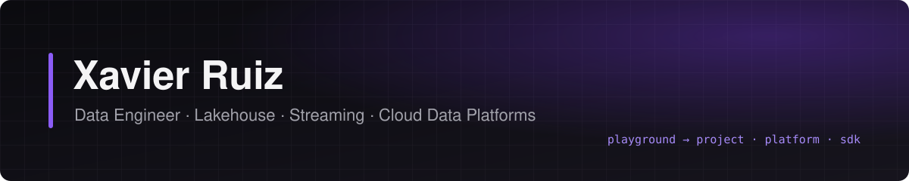
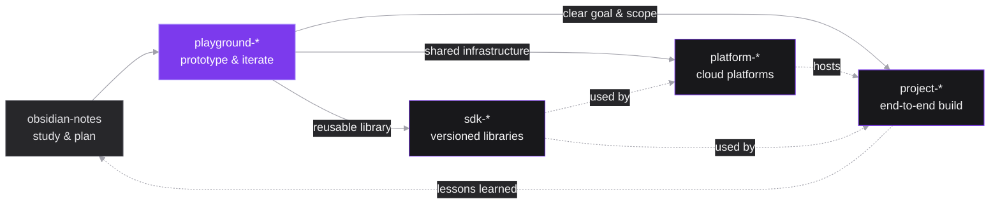

  

  
  
  

Data engineer focused on **lakehouse architectures, streaming & batch pipelines, and cloud data platforms** on GCP and AWS.

**Currently working on:** a cloud-agnostic Apache Iceberg lakehouse SDK in Java, a GitOps-managed unified data platform on GCP, and AI agents built with Google ADK.

  
  
  
  
  
  
  
  
  
  
  
  
  

## How I Learn: The Mastery Framework

I organize my learning in **[obsidian-notes](https://github.com/x-ruiz/obsidian-notes)**, a knowledge base built around six engineering categories. Each category is split into focus areas that I use as note tags. Each one also has a *leadership lens*: alongside the technical skill, I think about how I'd guide a team through it.

| Category | Focus areas | Where it shows up in my repos |
|---|---|---|
| **Cloud Infrastructure** | Architecture design, IaC, containers, networking, cloud services | Unified data platform, Steam analytics platform, GCP env CLI, container from scratch |
| **Data Processing** | ETL/ELT, big data frameworks, storage, streaming, data quality | Lakehouse SDK, Premier League, F1, CTA tracker, Airflow ETL |
| **Information Security** | Secure coding, authN/Z, secrets management, threat modeling, compliance | KMS-encrypted state & keyless WIF auth in the unified data platform |
| **Software Engineering** | Design principles & patterns, testing, build & CI/CD | Lakehouse SDK (SPI plugins, Template Method), LeetCode |
| **System Resiliency** | Observability, fault tolerance, chaos engineering, incident response, DR | *Up next* |
| **AI Engineering** | ML pipelines, agent development, MLOps, ethical AI | ADK agents in playground-ai-engineering |

Notes and reading → hands-on experiments → real projects. The repos below are the hands-on part.

## How My Repos Are Organized

Every repo name starts with a prefix that says what stage it's at:

| Prefix | Purpose |
|---|---|
| **`playground-*`** | **Where everything starts.** Incubator monorepos, one per discipline: data, cloud, and AI engineering. Here I prototype, write specs, take notes from books and courses, and iterate fast with no pressure to be "done." |
| **`project-*`** | **A self-contained build** with a clear goal and end-to-end scope. An idea graduates from a playground once it has a defined problem, a design, and enough substance to stand on its own. |
| **`platform-*`** | **Shared infrastructure.** Cloud platforms that other projects deploy onto and build on. They grow out of `playground-cloud-engineering`. |
| **`sdk-*`** | **Standalone libraries.** When a library built in a playground becomes stable enough to publish and version, it moves into its own `sdk-*` repo. |
| `tutorial-*` | Short, focused exercises for learning a single concept. |

Each project inside a playground is self-contained, with no imports across projects. That way it can be split out into its own repo, along with its CI workflows, when it's ready.

**Graduations in progress:**
- **`sdk_lakehouse` → `sdk-lakehouse`:** the [Lakehouse SDK](https://github.com/x-ruiz/playground-data-engineering/tree/main/maven_projects/sdk_lakehouse) is being developed through specs and iteration in `playground-data-engineering`. Its name already follows the `sdk-*` convention, so it keeps the same name when it moves out.
- **`platform_unified_data_gcp` → `platform-unified-data`:** a GCP unified data platform foundation being developed in `playground-cloud-engineering`.

## Featured

### [Lakehouse SDK](https://github.com/x-ruiz/playground-data-engineering/tree/main/maven_projects/sdk_lakehouse) · *playground → sdk-lakehouse*
A multi-module **Java 17** SDK for declarative, GitOps-style management of Iceberg namespaces and tables. One pipeline codebase applies the same YAML definitions to local MinIO, an AWS Iceberg REST catalog, or **Google BigLake**. You switch targets by changing environment config and dropping in a cloud plugin JAR, which is loaded through a `ServiceLoader` SPI.
 Java 17 · Apache Iceberg 1.10 · Maven · Docker · AWS · GCP BigLake

### Unified Data Platform · *playground → platform-unified-data*
A GCP data platform foundation managed through GitOps. It covers org and seed-project bootstrap, KMS-encrypted remote state, and keyless GitHub Actions auth through Workload Identity Federation (with separate plan and apply identities). The platform is composed from tag-pinned Cloud Foundation Fabric modules, with thin Terragrunt wrappers for `dev`, `uat` and `prod`. Applies to `uat` and `prod` are gated.
 OpenTofu · Terragrunt · GitHub Actions · GCP · Cloud Foundation Fabric

### [playground-ai-engineering](https://github.com/x-ruiz/playground-ai-engineering)
A monorepo of custom agent skills and **Google ADK** agents. The main project is the *Obsidian Note Generator*: give it a YouTube video, a blog post, or a docs URL and it writes a structured note that follows my vault's conventions. In other words, an AI agent that feeds my learning system.
 Python · Google ADK · LLM agents

## Playgrounds

| Repo | What's inside |
|---|---|
| [playground-data-engineering](https://github.com/x-ruiz/playground-data-engineering) | The Lakehouse SDK, a weather pipeline, and notes from *Spark: The Definitive Guide* and *Taming Big Data* |
| `playground-cloud-engineering` (private) | Infrastructure-as-code, GitOps patterns, and platform foundations, including the Unified Data Platform on GCP |
| [playground-ai-engineering](https://github.com/x-ruiz/playground-ai-engineering) | Google ADK agents and agent skills |

## Projects

### Data Engineering
| Project | What it does | Stack |
|---|---|---|
| [project-premier-league-analytics](https://github.com/x-ruiz/project-premier-league-analytics) | Ingests Premier League stats from a football API into GCS as Avro, transforms them into team and player tables, and serves a dashboard. Ingestion schedules are managed with Terraform. | Java, Avro, Jib, GCS, Terraform |
| [project-formula-1-wc-analytics](https://github.com/x-ruiz/project-formula-1-wc-analytics) | Historical F1 championship dashboards. Airflow ETL loads Kaggle data into GCS as Parquet and enriches it with city population data. Built for UChicago Applied Data Analytics. | Python, Airflow (Astro), Pandas, GCS, Parquet |
| [project-cta-tracker](https://github.com/x-ruiz/project-cta-tracker) | Streams real-time transit data: a Python producer publishes to Kafka and a Flink job consumes it. | Python, Kafka, Flink, Java |
| [project-market-data-airflow-etl](https://github.com/x-ruiz/project-market-data-airflow-etl) | Airflow DAGs that extract and process market data. | Python, Airflow |
| [project-apple-analysis](https://github.com/x-ruiz/project-apple-analysis) | An introductory extract → transform → load pipeline built with factory-pattern classes, run on Databricks. | Python, PySpark, Databricks |

### Cloud & Platform Engineering
| Project | What it does | Stack |
|---|---|---|
| [project-steam-analytics-platform](https://github.com/x-ruiz/project-steam-analytics-platform) | A Steam gaming analytics app with a Go (Gin) API, a React + Nivo charts frontend, and GCP infrastructure provisioned with Terraform. | Go, React, Terraform, GCP |
| [project-go-image-uploader](https://github.com/x-ruiz/project-go-image-uploader) | A containerized web app for uploading images to Google Cloud Storage. | Go, Gin, GCS, Docker |
| [cli-gcp-environment-configuration](https://github.com/x-ruiz/cli-gcp-environment-configuration) | A Python CLI that automates setting up a new GCP project environment. | Python, GCP |
| [backstage-ansible-awx](https://github.com/x-ruiz/backstage-ansible-awx) | A Backstage developer-portal plugin that integrates Ansible AWX. | TypeScript, Backstage |

## Tutorials & Learning

| Repo | What it covers |
|---|---|
| [obsidian-notes](https://github.com/x-ruiz/obsidian-notes) | The Mastery Framework knowledge base described above |
| [tutorial-go-container-from-scratch](https://github.com/x-ruiz/tutorial-go-container-from-scratch) | A minimal container runtime in Go, built from Linux namespaces, cgroups, and chroot |
| [tutorial-go-url-shortener](https://github.com/x-ruiz/tutorial-go-url-shortener) | A URL shortener HTTP service in Go |
| [tutorial-tf-website-bucket](https://github.com/x-ruiz/tutorial-tf-website-bucket) | Hosting a static website from a cloud bucket provisioned with Terraform |
| [tutorial-hadoop-word-count](https://github.com/x-ruiz/tutorial-hadoop-word-count) | The classic Hadoop MapReduce word count |
| [gcp-associate-cloud-engineer-course](https://github.com/x-ruiz/gcp-associate-cloud-engineer-course) | Course material and code for the GCP Associate Cloud Engineer certification |
| [leetcode](https://github.com/x-ruiz/leetcode) | Algorithm practice in Go |
| [resources](https://github.com/x-ruiz/resources) | Cheat sheets and reference links |

<b>Sunset projects</b>

- [project-ps5-trophy-tracker](https://github.com/x-ruiz/project-ps5-trophy-tracker): a proof of concept for a PlayStation trophy tracker (JavaScript, Cloud Functions). It was sunset because the unofficial PSN API's authentication broke.

  

